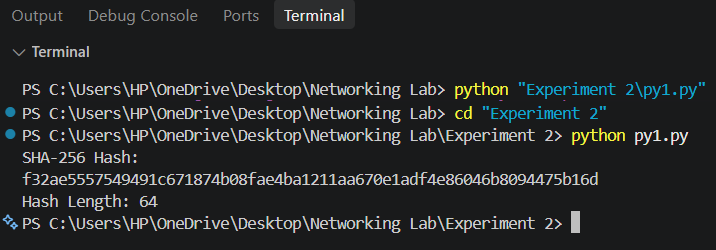
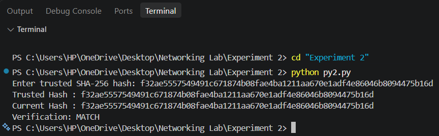
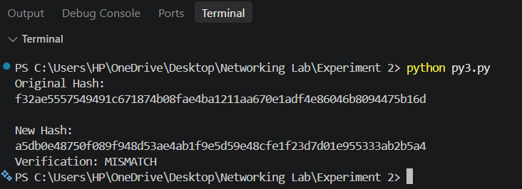

# Experiment 2: Cryptographic Hashing & Data Integrity Verification (SHA-256)

## 🎯 Aim & Objectives
To demonstrate the principles of cryptographic hash functions using **SHA-256 (Secure Hash Algorithm 256-bit)** in Python:
- Compute deterministic 256-bit digests of arbitrary file contents.
- Verify file authenticity against trusted checksums.
- Demonstrate the **Avalanche Effect** and tamper detection through subtle payload modifications.

---

## 📚 Theoretical Background

### What is a Cryptographic Hash Function?
A cryptographic hash function $H: \{0, 1\}^* \to \{0, 1\}^n$ maps arbitrary-length input data to a fixed-length bit string (256 bits for SHA-256, rendered as 64 hexadecimal characters).

### Fundamental Properties
1. **Deterministic:** Identical inputs always produce the exact same hash output.
2. **Pre-image Resistance (One-Way):** Given digest $h$, it is computationally infeasible to find $m$ such that $H(m) = h$.
3. **Second Pre-image Resistance (Weak Collision Resistance):** Given input $m_1$, it is computationally infeasible to find $m_2 \ne m_1$ such that $H(m_1) = H(m_2)$.
4. **Collision Resistance (Strong Collision Resistance):** Infeasible to find any two distinct messages $m_1 \ne m_2$ with $H(m_1) = H(m_2)$.
5. **Avalanche Effect:** Flipping even a single bit in the input radically scrambles the entire digest output ($>50\%$ bit flip expectation).

---

## 💻 Source Code Walkthrough

### 1. Generating SHA-256 Hash (`01_sha256_hash.py`)
Reads binary file data and outputs the 64-character hexadecimal digest:
```python
import hashlib

file = open("sample.txt", "rb")
data = file.read()
file.close()

hash_value = hashlib.sha256(data).hexdigest()

print("SHA-256 Hash:")
print(hash_value)
print("Hash Length:", len(hash_value))
```

### 2. Verifying File Authenticity (`02_hash_verification.py`)
Compares the computed digest with an expected reference hash:
```python
import hashlib

file = open("sample.txt", "rb")
data = file.read()
file.close()

current_hash = hashlib.sha256(data).hexdigest()

trusted_hash = input("Enter trusted SHA-256 hash: ")

print("Trusted Hash :", trusted_hash)
print("Current Hash :", current_hash)

if trusted_hash == current_hash:
    print("Verification: MATCH")
else:
    print("Verification: MISMATCH")
```

### 3. Detecting Tampering & The Avalanche Effect (`03_integrity_check.py`)
Simulates an unauthorized alteration (changing an uppercase character to lowercase) and re-evaluates the checksum:
```python
import hashlib

file = open("sample.txt", "rb")
data = file.read()
file.close()

original_hash = hashlib.sha256(data).hexdigest()

print("Original Hash:")
print(original_hash)

# Modify one character: 'N' -> 'n'
file = open("sample.txt", "w")
file.write("network Security is important.")
file.close()

file = open("sample.txt", "rb")
data = file.read()
file.close()

new_hash = hashlib.sha256(data).hexdigest()

print("\nNew Hash:")
print(new_hash)

if original_hash == new_hash:
    print("Verification: MATCH")
else:
    print("Verification: MISMATCH")
```

---

## 🚀 Execution & Verification

### Step 1: Compute Baseline File Hash
```bash
python 01_sha256_hash.py
```
Outputs the 256-bit hexadecimal string and validates its 64-character length.



---

### Step 2: Validate Against Known Trusted Checksum
```bash
python 02_hash_verification.py
```
When provided with the matching hash, the verification yields `MATCH`.



---

### Step 3: Test Tamper Detection
```bash
python 03_integrity_check.py
```
A one-character file modification results in an entirely different digest, triggering an immediate `MISMATCH`.



---

## 🔍 Key Observations & Results
- **Integrity Guarantee:** Any unauthorized modification in transit or at rest is instantly detectable.
- **Fixed-Width Digest:** Regardless of file size (bytes to terabytes), SHA-256 always produces a compact 32-byte (256-bit) digest.
- **Real-World Applications:** Software distribution checksums (apt/rpm/pip), digital signatures, blockchain block headers, and file deduplication.
