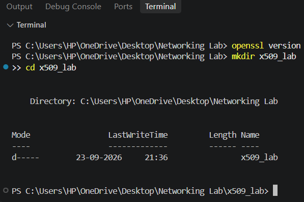
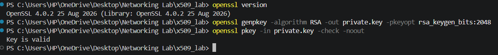
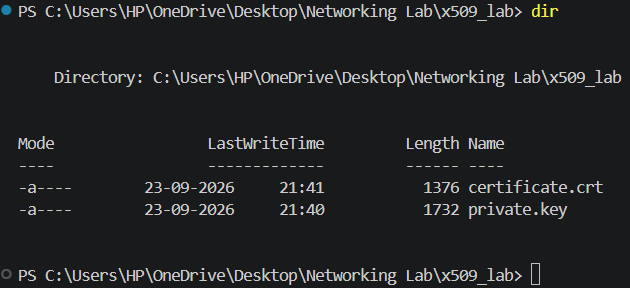
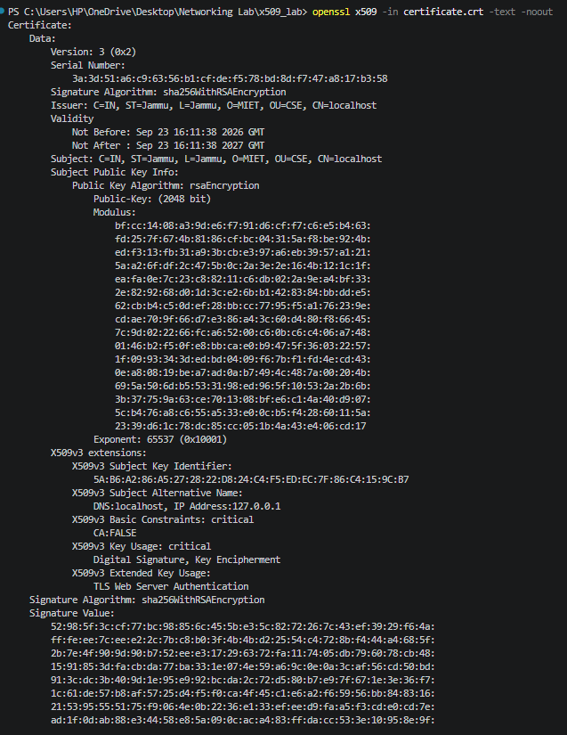
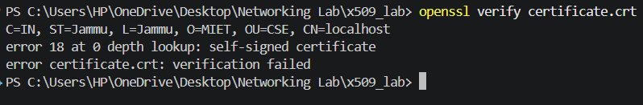
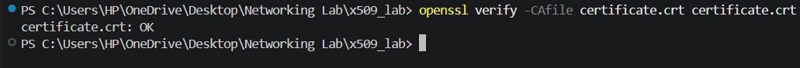
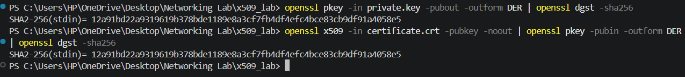

# Experiment 4: Public Key Infrastructure (PKI) & X.509 Digital Certificates using OpenSSL

## 🎯 Aim & Objectives
To generate, inspect, validate, and verify an **X.509 v3 Digital Certificate** and its cryptographic key pair using the **OpenSSL CLI**:
- Generate an asymmetric 2048-bit RSA private key and validate key integrity.
- Issue a self-signed X.509 digital certificate with modern v3 extensions (SAN, Basic Constraints, Key Usage, Extended Key Usage).
- Inspect and parse certificate fields, serial numbers, validity windows, and subject identifiers.
- Test certificate chain validation against default vs. explicit trust stores.
- Cryptographically prove key-pair consistency by comparing public key SHA-256 digests.

---

## 📚 Theoretical Background

### 1. Public Key Infrastructure (PKI)
PKI provides the framework of trust for secure internet communication (HTTPS, TLS, S/MIME, code signing). It binds cryptographic public keys to validated identities using digital certificates signed by Certificate Authorities (CAs).

### 2. X.509 Certificate Architecture
An X.509 v3 certificate includes:
- **Version & Serial Number:** Unique identifier assigned by the issuer.
- **Signature Algorithm:** e.g., `sha256WithRSAEncryption`.
- **Issuer & Subject DN:** Distinguished Name fields (`CN`, `O`, `OU`, `L`, `ST`, `C`).
- **Validity Period:** `Not Before` and `Not After` timestamps.
- **Subject Public Key Info:** Algorithm (`RSA 2048-bit`) and public modulus/exponent.
- **v3 Extensions:**
  - `Subject Alternative Name (SAN)`: Modern browsers require SAN (`DNS:localhost, IP:127.0.0.1`) instead of deprecated CN matching.
  - `Basic Constraints`: Identifies whether certificate belongs to an end-entity (`CA:FALSE`) or CA (`CA:TRUE`).
  - `Key Usage`: Defines allowed operations (`digitalSignature, keyEncipherment`).
  - `Extended Key Usage`: Application-level usage (`serverAuth`).

---

## 🛠️ Step-by-Step Procedure & Commands

### Step 1: OpenSSL Environment Setup
Verify OpenSSL installation and create a dedicated workspace:
```bash
openssl version
mkdir x509_lab
cd x509_lab
```


---

### Step 2: Generate & Validate RSA 2048-bit Private Key
Generate a cryptographically secure 2048-bit RSA private key and confirm key structure:
```bash
openssl genpkey -algorithm RSA -out private.key -pkeyopt rsa_keygen_bits:2048
openssl pkey -in private.key -check -noout
```
- Output confirms: `Key is valid`.



---

### Step 3: Issue Self-Signed X.509 Certificate with Extensions
Generate the X.509 certificate with Subject details and security extensions:
```bash
openssl req -new -x509 -sha256 -key private.key -out certificate.crt -days 365 \
  -subj "/C=IN/ST=Jammu/L=Jammu/O=MIET/OU=CSE/CN=localhost" \
  -addext "subjectAltName=DNS:localhost,IP:127.0.0.1" \
  -addext "basicConstraints=critical,CA:FALSE" \
  -addext "keyUsage=critical,digitalSignature,keyEncipherment" \
  -addext "extendedKeyUsage=serverAuth"
```



---

### Step 4: Parse & Inspect Certificate Metadata
Read the human-readable text dump of all certificate fields:
```bash
openssl x509 -in certificate.crt -text -noout
```
- Displays Issuer, Validity period, Subject, Public Key Algorithm, Extensions (SAN, BasicConstraints, EKU), and SHA-256 signature algorithm.



---

### Step 5: Default Certificate Chain Validation (Expected Failure)
Attempt standard certificate verification against system trust store:
```bash
openssl verify certificate.crt
```
- **Result:** Fails with `error 18 at 0 depth lookup: self signed certificate`.
- **Reason:** System trust anchors do not recognize untrusted self-signed root certificates without explicit CA installation.



---

### Step 6: Explicit Trust Anchor Verification (Successful)
Supply the certificate as its own trusted CA anchor:
```bash
openssl verify -CAfile certificate.crt certificate.crt
```
- **Result:** `certificate.crt: OK`.
- **Reason:** Explicitly declaring the certificate as trusted allows the validator to construct a valid zero-depth chain.



---

### Step 7: Cryptographic Consistency Verification (Key Pair Matching)
Extract the public key from the private key and from the certificate, convert to DER format, and hash with SHA-256:
```bash
# Public key from Private Key
openssl pkey -in private.key -pubout -outform DER | openssl dgst -sha256

# Public key from X.509 Certificate
openssl x509 -in certificate.crt -pubkey -noout | openssl pkey -pubin -outform DER | openssl dgst -sha256
```
- **Result:** Both SHA-256 digests match bit-for-bit, proving that the certificate was indeed signed and issued using the matching private key.



---

## 🔍 Key Observations & Results
1. **Asymmetric Binding:** OpenSSL provides robust primitives for binding cryptographic identity to public keys.
2. **Trust Chain Mechanics:** Standard clients require a chain leading to pre-installed trusted root CAs; self-signed certificates require manual CA pinning or local installation.
3. **SAN Requirement:** Modern TLS implementations mandate Subject Alternative Name attributes over standard Common Name fields to prevent hostname spoofing.
