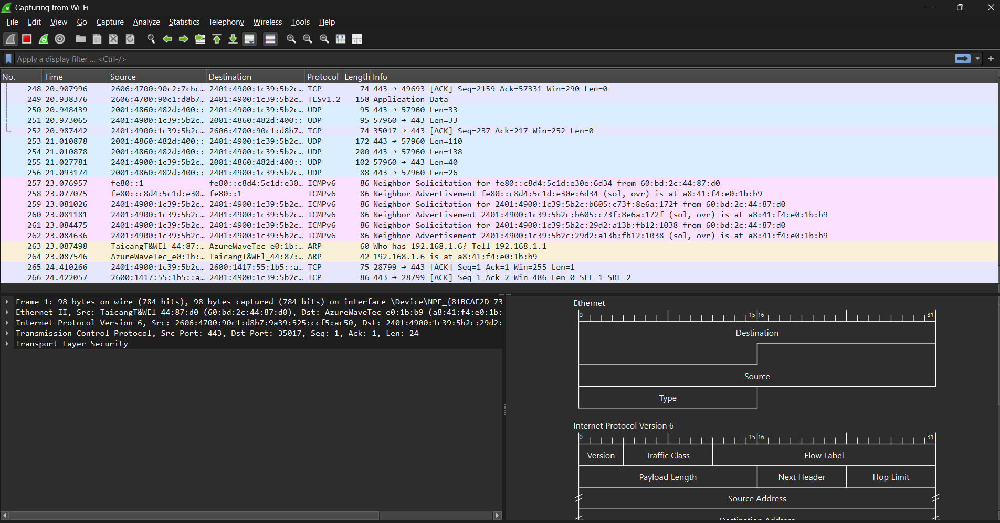
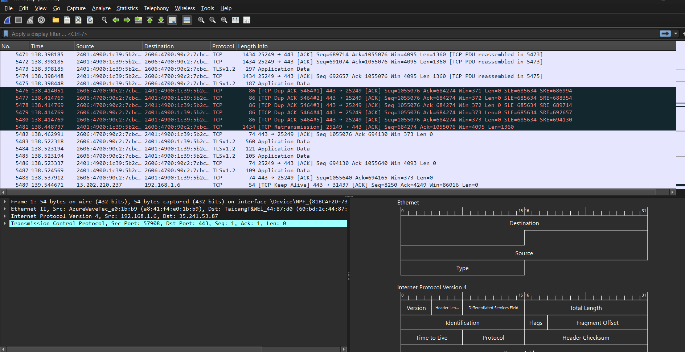
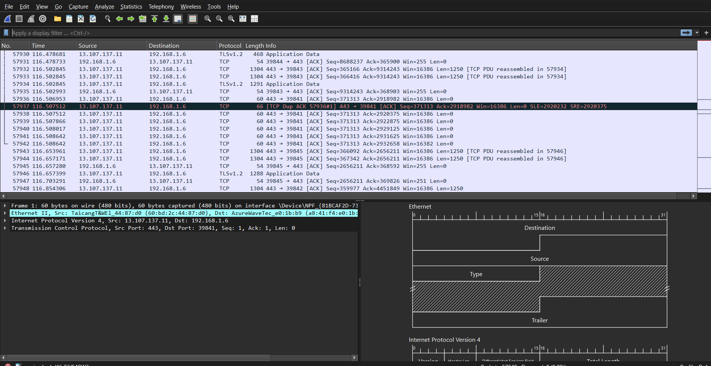
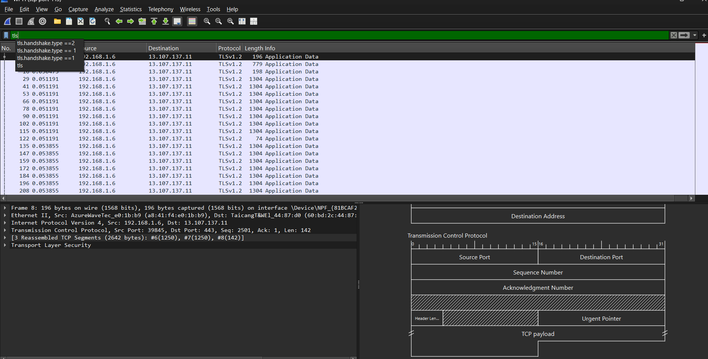
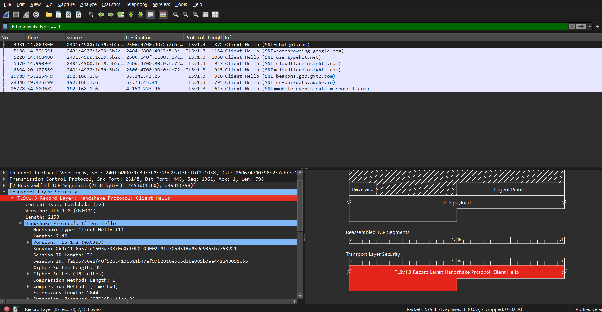
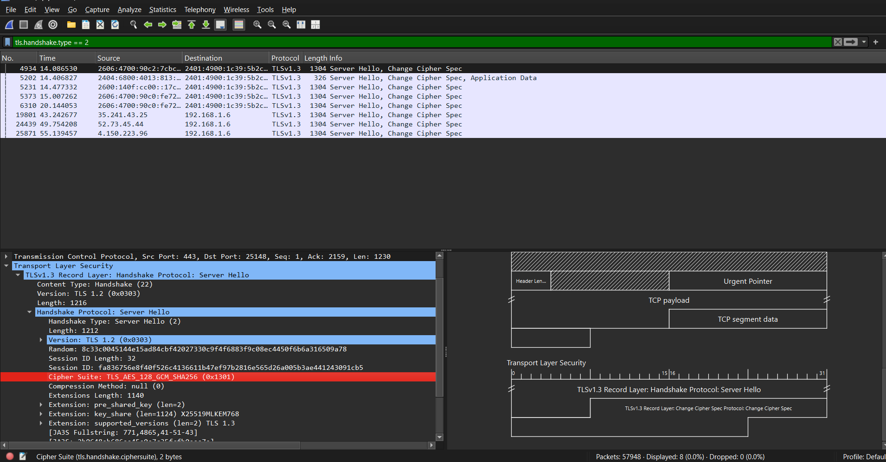
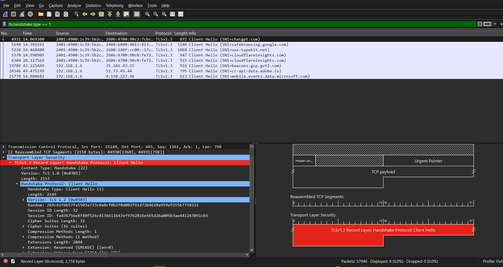
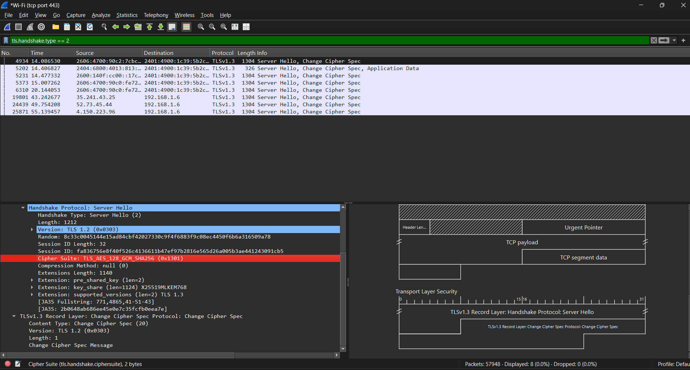
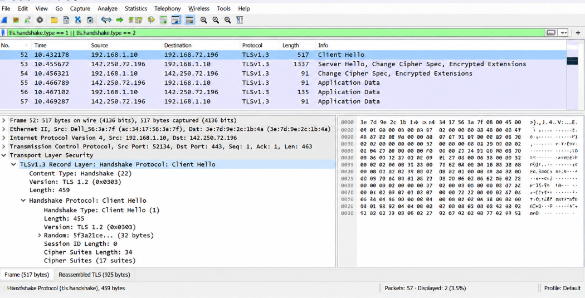

# Experiment 5: TLS Handshake Protocol Analysis using Wireshark

## 🎯 Aim & Objectives
To capture, analyze, and dissect the **Transport Layer Security (TLS)** handshake process during secure HTTPS communication over TCP Port 443 using **Wireshark**:
- Capture live cryptographic network traffic between client and remote HTTPS web servers.
- Trace the sequence of handshake messages from initial TCP setup to symmetric session key establishment.
- Dissect the **Client Hello** and **Server Hello** protocol records.
- Analyze cipher suite negotiation, cryptographic nonces, and Public Key exchange mechanisms.
- Examine Wireshark's TLS dissector configuration and decryption preferences.

---

## 📚 Theoretical Background

### 1. Transport Layer Security (TLS) Architecture
TLS provides end-to-end communication security over the transport layer (TCP). It ensures three fundamental security guarantees:
- **Confidentiality:** Data payload encrypted using symmetric ciphers (e.g., AES-GCM, ChaCha20).
- **Integrity:** Message Authentication Code or Authenticated Encryption (AEAD) ensures no packet tampering.
- **Authentication:** Server identity validated via digital X.509 certificates.

```
 Client                                              Server
   |                                                   |
   | ------------ 1. TCP SYN ------------------------> |
   | <----------- 2. TCP SYN-ACK --------------------- |
   | ------------ 3. TCP ACK ------------------------> |
   |                                                   |
   | ------------ 4. Client Hello -------------------> |
   | <----------- 5. Server Hello -------------------- |
   | <----------- 6. Server Certificate -------------- |
   | <----------- 7. Server Key Exchange (ECDHE) ----- |
   | <----------- 8. Server Hello Done --------------- |
   |                                                   |
   | ------------ 9. Client Key Exchange ------------> |
   | ----------- 10. Change Cipher Spec -------------> |
   | ----------- 11. Encrypted Handshake Message ----> |
   |                                                   |
   | <---------- 12. Change Cipher Spec -------------- |
   | <---------- 13. Encrypted Handshake Message ----- |
   |                                                   |
   | <======== Encrypted Application Data (HTTPS) ===> |
```

### 2. Cipher Suite Anatomy
A negotiated cipher suite defines the cryptographic primitives:
$$\underbrace{\text{TLS}}_{\text{Protocol}}\_\underbrace{\text{ECDHE}}_{\text{Key Exchange}}\_\underbrace{\text{RSA}}_{\text{Authentication}}\_\underbrace{\text{WITH\_AES\_128\_GCM}}_{\text{Bulk Encryption}}\_\underbrace{\text{SHA256}}_{\text{MAC / PRF}}$$

---

## 🛠️ Step-by-Step Procedure & Wireshark Analysis

### Step 1: Interface Selection
Launch Wireshark and choose the active network interface carrying internet traffic (e.g., Wi-Fi or Ethernet adapter).



---

### Step 2: Configure Display and Capture Filters
Set the capture filter for standard HTTPS communication:
```
tcp.port == 443
```
Alternatively, in display filter use `tls` or `ssl` to isolate cryptographic handshake frames.



---

### Step 3: Trigger HTTPS Web Traffic
In a browser, navigate to a secure domain (e.g., `https://example.com` or local HTTPS service) while Wireshark actively logs packets.



---

### Step 4: Isolate TLS Protocol Packets
Locate the initial TCP 3-way handshake (SYN, SYN-ACK, ACK) immediately followed by the TLS Handshake records.



---

### Step 5: Dissect Client Hello
Inspect the `Client Hello` message sent from client to server:
- **TLS Version:** Highest version supported by client (e.g., TLS 1.2 / TLS 1.3).
- **Client Random:** 32-byte cryptographic random nonce ($t_{\text{gmt}} \parallel \text{random\_bytes}$).
- **Cipher Suites List:** Ordered list of cipher suites supported by the client.
- **Extensions:**
  - `server_name` (SNI - Server Name Indication): Specifies target hostname.
  - `elliptic_curves` / `supported_groups`: Supported curve parameters (e.g., x25519, secp256r1).
  - `signature_algorithms`: Supported hashing and signing algorithms.



---

### Step 6: Dissect Server Hello
Inspect the `Server Hello` response from server:
- **Server Random:** 32-byte cryptographic nonce from server.
- **Selected TLS Version:** Agreed protocol version.
- **Selected Cipher Suite:** Single chosen cipher suite matching client capabilities.
- **Session ID:** ID for potential session resumption.



---

### Step 7: Parameter Negotiation & Handshake Completion
Analyze subsequent handshake frames:
- **Certificate:** Server transmits its X.509 certificate chain.
- **Server Key Exchange:** Server transmits Diffie-Hellman ephemeral parameters signed with its private key.
- **Server Hello Done:** Notifies client that server phase is complete.
- **Client Key Exchange & Finished:** Both parties derive the premaster secret, compute master secret, and exchange verification hashes.



---

### Step 8: Detailed Cipher Suite Evaluation
Inspect negotiated cryptographic strength:
- Key exchange: Ephemeral Diffie-Hellman provides **Forward Secrecy (PFS)**.
- Symmetric Cipher: Authenticated Encryption with Associated Data (AEAD) eliminates separate HMAC overhead.



---

### Step 9: Wireshark TLS Preferences & SSLKEYLOGFILE
Examine Wireshark's TLS protocol dissector preferences:
- Configuring `(Pre)-Master-Secret log filename` enables Wireshark to decrypt TLS traffic on-the-fly when SSLKEYLOGFILE environment variable is exported by the browser.



---

## 🔍 Key Observations & Results
1. **Cleartext Handshake vs. Encrypted Data:** While SNI, cipher suites, and server certificates are visible in initial TLS 1.2 handshake frames, all subsequent HTTP request/response payloads remain fully encrypted.
2. **Forward Secrecy:** Modern ECDHE suites ensure that compromise of server long-term private keys does not decrypt previously recorded sessions.
3. **Defense Against MITM:** Certificate chain verification ensures clients only establish session keys with validated domain owners.
